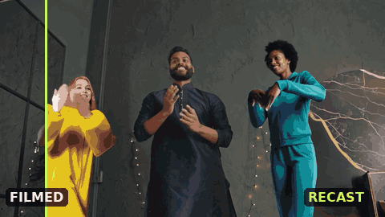
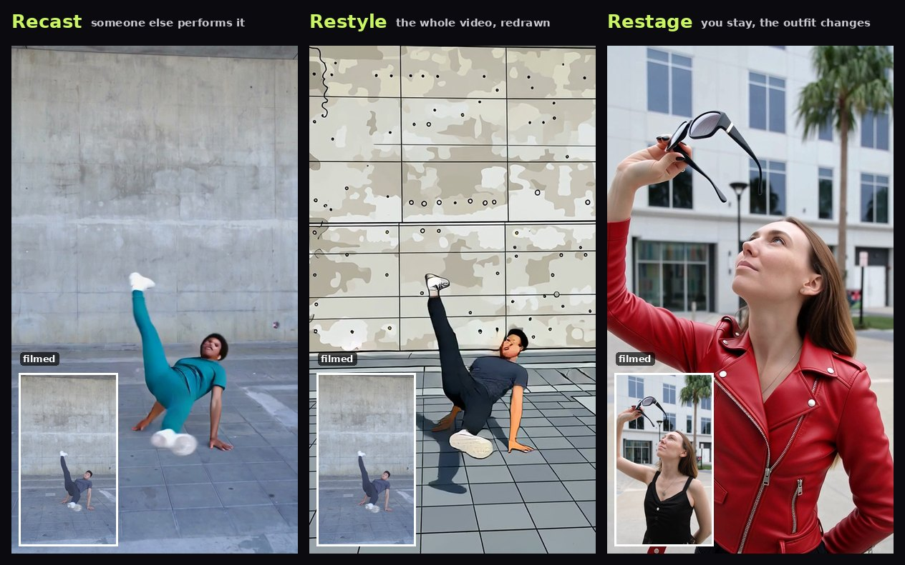

# Understudy



*Two of three dancers recast as a woman in a yellow raincoat and a runner in teal. The dancer between them
stays exactly as filmed. Real app output; the source is a licensed Pexels clip.*

Film something. Choose who in the clip is recast, and as whom. Get the same performance back, played by
your characters, in your own room, with everyone you didn't choose left exactly as filmed, your original
audio, a side-by-side comparison and a `recipe.json` with the exact graph that made it.

> **Entry for Comfy's #OpenSourceHiggsfield challenge, Open Weights Only.** No partner nodes, API nodes or
> closed models anywhere in the path: every model is downloadable open weights, run through the official
> [Comfy SDK](https://docs.comfy.org/development/api-development/sdks) against a self-hosted ComfyUI behind
> [`comfy-api-proxy`](https://github.com/Comfy-Org/comfy-api-proxy).

**[What's new here](#whats-new-here)** · **[Run it yourself](#run-it-yourself)** · **[How it runs](#how-it-runs)**



## What's new here

1. **You tap who changes.** SAM 3.1 finds everyone in the first frame; the people you tap start the video
   tracker, with no words involved. Everyone you didn't tap is tracked through the whole clip and put back as
   filmed, so a recast never leaks onto a bystander.
2. **The preview is the real start of the video.** It renders the video's first 5 seconds with the same graph
   and seed, so a 5 s video costs no second render.
3. **Every result can be made again.** `recipe.json` holds the exact ComfyUI API graph, seed, settings and input
   hashes, and Recreate opens it in the app, ready to change.

## Three modes

| Mode | What changes | How |
|---|---|---|
| **Recast** | Someone else performs your moves, from one character photo. Up to two performers, in the clip's own place or another one. | SCAIL-2 (Wan2.1 14B), tracked by SAM 3.1. Another place starts from a picture made with Qwen-Image-Edit-2511. |
| **Restyle** | The whole video, redrawn in a look: anime, toy, pixel art, comic ink and more. | Wan2.1 VACE 14B, video to video on a depth map of every frame, so things that happen later in the clip still happen. |
| **Restage** | You stay you. New clothes for anyone you choose, a new place, or both. | SCAIL-2 recasts you as yourself, so the clip still drives every frame. Each new outfit is put on with Qwen-Image-Edit-2511 first. |

## What it adds over the stock workflows

- **You choose who is recast.** SAM 3.1 finds everyone in the start frame. You tap up to two people, and
  their masks start the video tracker, with no words involved, so two people dressed alike are still told
  apart. Words can't do this: tracking "man" in a crowd followed a passer-by, and the clip reader named a
  different man on each read.
- **Everyone else stays as filmed.** SCAIL-2 redraws the whole frame, so bystanders came back changed, some
  wearing the new character's glasses. Everyone not chosen is tracked over the whole clip and put back as
  filmed, colour-matched to the render. That includes people who walk in after the first frame.
- **Each character lands on the right person.** SCAIL-2 decides who becomes whom by where the characters
  sit on its reference picture, not by the tracking masks or the prompt; we tested both. So each character
  is cut out of their photo and placed where their performer stands.
- **The preview is the real start of your video.** In the clip's place, the preview renders the video's first
  5 seconds, which is exactly the render's first chunk, with the same graph and seed. A 5 s video is that chunk,
  so keeping it needs no second render. While it renders, the page shows who replaces whom, plus the job's
  progress through each phase.
- **Restyle reads your clip.** Depth can't see sunglasses against a face, so Qwen3-VL looks at four moments of
  the clip and names what the performers put on, take off or pick up; you can edit that line. Background events
  are left out on purpose: naming a far-off cyclist pulled him into the foreground.
- **Every result can be made again.** A finished render's Recreate opens Create with the same clip, the people
  chosen in it, the pictures, their words and every setting, ready to change. The Examples page does the same
  for videos made here: each one's clip and pictures are copied into the visitor's own uploads.
- **It never says what isn't there.** "No glasses" in a prompt only adds the word glasses. Negations are
  removed from the character's words and the render prompt, and the character is cut out of their photo, so a
  helmet on the desk beside them
  can't become their headgear.
- **Reproducible.** `recipe.json` records the input hashes, every setting, the seed, the models, the exact
  ComfyUI API graph it ran (it opens in ComfyUI), and each step done after it.

- **Any length, paid by the second.** Ask for 2 to 20 seconds of your clip. The video renders in 5 s chunks,
  each anchored on the last frames of the one before, and the last chunk is only as long as it needs to be. A
  render costs one credit per second it delivers; previews are free, and a failed render is refunded.

Every problem met while building this, and how each was fixed, is in
[docs/PROBLEMS_AND_FIXES.md](docs/PROBLEMS_AND_FIXES.md). The measurements behind each claim are in
[bench/RESULTS.md](bench/RESULTS.md).

## How it runs

```
web app (React)  ->  server/app.py (FastAPI)  ->  comfy-sdk  ->  comfy-api-proxy  ->  ComfyUI
```

The server builds every graph from bounded parameters (`recast/`), so nothing a visitor sends reaches ComfyUI
as a raw workflow. GPU work runs in two lanes: **quick** (finding people, reading pictures and clips,
image-edit previews) and **heavy** (renders, and the clip's-place preview, which is a render). Each lane runs
one task at a time, so a picker never waits behind a render. The only machine settings are the endpoints:
`COMFY_BASE_URL` (plus `COMFY_API_KEY`) and, optionally, `COMFY_QUICK_BASE_URL` for a second GPU. The
judge build runs both lanes on Modal ([deploy/modal/](deploy/modal/)).

## Judge links and the admin page

With `RECAST_LINKS=1` the server answers only browsers that opened a link: everything made through a link is
seen only through it, and each link has its own credits. Make, list and revoke links with
`tools/make_link.py`, or at `/admin` when `RECAST_ADMIN_PASSWORD` is set, where each link's use is shown too.
Only a hash of each link is stored, so a link is shown once, when it is made.

## Run it yourself

The app itself needs Python 3.10+, Node 20+ and `ffmpeg` on the PATH. It renders on a ComfyUI v0.41.3 with
the models in [manifests/models.json](manifests/models.json) (pinned Hugging Face revisions, sizes and SHA-256
hashes) and three custom node packs, behind `comfy-api-proxy` 0.1.6. There are two ways to get one.

**On Modal, with no GPU of your own.** [deploy/modal/](deploy/modal/README.md) builds ComfyUI, the node packs
and the proxy into an image, downloads the models into a Volume, and publishes two HTTPS endpoints. This is
how the judge build runs. GPU time is billed to your Modal account.

**On your own ComfyUI** (measured on a 16 GB card):

```bash
python3 tools/fetch_models.py /path/to/ComfyUI   # about 63 GiB, every file hash-checked, plus the 3 node packs
# then install each new pack's requirements.txt into ComfyUI's Python, restart ComfyUI, and start the proxy:
pip install comfy-api-proxy==0.1.6
comfy-api-proxy run --comfyui http://127.0.0.1:8188 --host 127.0.0.1 --port 8189 --state-dir ./proxy-state
```

**Then the app**, the same for both:

```bash
uv venv && uv pip install -e ".[dev,server]"
(cd web && npm install)
cp .env.example .env          # COMFY_BASE_URL: your proxy, or the Modal endpoints and COMFY_API_KEY
tools/serve_local.sh          # backend on :8780, web app on http://localhost:5180
.venv/bin/python -m pytest -q # CPU-only tests, no GPU needed
```

A fresh checkout has no example clips or Examples: the clips are third-party videos and are not in git. Upload
your own clip to start, or run `python3 tools/fetch_examples.py` to rebuild the six example clips from Pexels
(the music is a by-hand download, see [examples/README.md](examples/README.md)). Then `tools/add_presets.py`
lists them under "Use one of ours", and `tools/add_gallery.py <spec.json>` turns finished jobs into Examples to watch and recreate (copy
`runs/app/gallery/` into another server's data folder to show them there).

The `recast` CLI (`recast run`, `recast match`, `recast styles`) is the first version of the pipeline, on Wan
Animate-2, kept for comparison. `--dry-run` writes its graphs without a GPU.

Measured render times for 5 s of video. On a 16 GB RTX 4070 Ti SUPER, which offloads part of the 14B models:
Recast and Restage 10.5 to 15 minutes (20 runs), Restyle about 5 minutes (6 runs). On Modal's L40S lane: a
Recast took 3.3 minutes and a Restyle 2.2 (one run each). The clip's-place preview takes as long as that render,
since it is that render.

## Limits (honest list)

- Up to two performers. With four chosen, one standing half behind a person kept as filmed bled into them
  (a beard showing through a cheek); with two, SCAIL-2's other two places go to neighbours who touch the
  chosen ones, which keeps them from being redrawn. A new place starts from one image edit, which holds two
  people. Anyone hidden behind another person in the start frame isn't found, so they can't be chosen.
  People in clear view work best.
- Native size: 576x1024 for tall clips and 1024x576 for wide ones; 3:4, 4:3 and square at about 480p, and
  Restyle at 480p (not yet measured larger). All at 16 fps, SCAIL-2's own rate. 720p and 1080p output are a
  lanczos upscale, and the result page says so. Fast hands smear.
- One character's likeness drifts younger in some runs. Logos and printed text on clothes turn into invented
  text. Small accessories from a reference photo (glasses) appear in some renders and not others.
- A performer keeps their own build and way of moving; only how they look changes. A dog recast as a cat
  came out a dog-shaped cat (a dog's size, legs and gait), so pick a character with a similar body. Two
  animals at a keyboard were recast as two men, in either order. In one test a person could not be put on a dog standing on four
  legs: the model drew the person on the human performer instead, whatever the reference said. An animal's
  tail counts as part of its body: a cat recast as a woman in jeans grew a third leg where the tail was.
- Restyle changes places more than people: in Pixel Art and Watercolor the background takes the look while
  a performer stays close to filmed. Over a 10 s Restyle, details are redrawn as it goes (a dog's coat
  gained spots, trousers changed colour); the joins themselves show no jump.
- In the clip's place the room is the model's own, graded to the clip's colours as a whole (bench/RESULTS.md).
- Jobs on the same lane queue: two visitors rendering at once wait for each other.
- Four chunks at most: a 20 s ask delivers about 19.3 s in Recast and Restage and 18.6 s in Restyle, and is
  charged for what it delivers.

## Licence

MIT for this repository's code ([LICENSE](LICENSE)). Models, ComfyUI and the custom nodes keep their own
licences, and every model used allows commercial use: see [THIRD_PARTY_NOTICES.md](THIRD_PARTY_NOTICES.md).

## Contributing / publishing rules

Nothing machine-specific, private or unlicensed enters git: no media, no weights, no IPs, paths or usernames, no
third-party clips. `tools/install_hooks.sh` installs a pre-commit check (`tools/check_public.py`) that enforces
this. Machine details live in `.env` (see `.env.example`).
